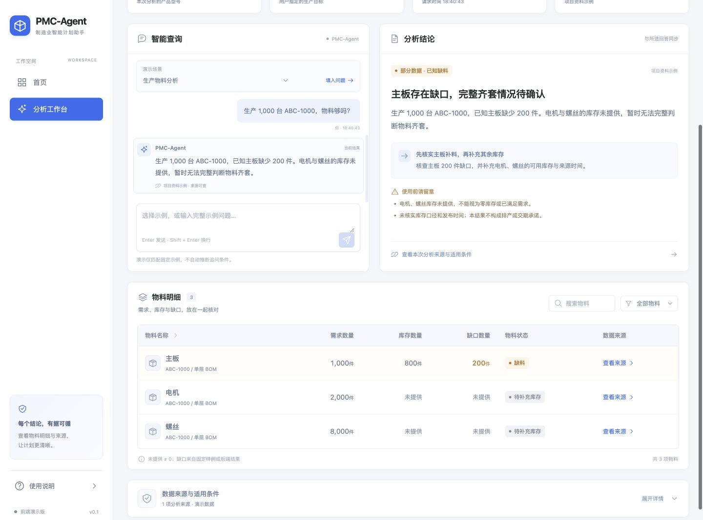
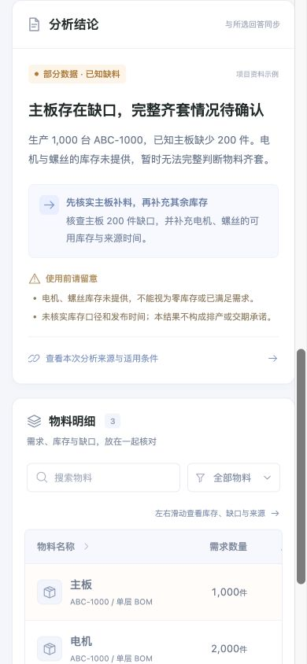

# PMC-Agent 当前比赛展示前端

Vue 3 + TypeScript + Vite 前端，包含首页、智能分析工作台、物料明细、来源展示及桌面/手机适配。

已接入主项目 v1.14 统一 Agent API，默认在线模式，不再默认使用 mock。
根目录 `frontend/` 为 legacy；本目录下的 `frontend/` 才是当前比赛展示与维护入口。

## 安装与启动

需要 Node.js 22.12+。

从 PMC-Agent 主项目根目录运行：

```powershell
Set-Location pmc-agent-frontend-main/frontend
npm install
npm run dev
```

默认前端地址 `http://127.0.0.1:5173`，默认 API 地址 `http://127.0.0.1:8000`。
无需 `.env.local` 即可使用默认 API；自定义地址按下方完整运行说明配置。
Windows 可双击主项目根目录 `start-frontend.bat`，后端按原方式另行启动。
端口严格为 5173；若旧前端正在占用，先在其终端按 Ctrl+C 停止。
临时指定其他端口时，须确认后端 CORS 允许该 origin，不能假定自动放行。

```bash
npm run build
npm run preview
```

## 仓库内容

- `frontend/`：当前比赛展示与维护工程；真实 API 客户端、适配层及保留的离线 fixtures。
- 主项目根目录 `frontend/`：legacy，保留兼容回归，不作为默认入口，不复制代码到本目录。
- `outputs/`：交付 ZIP、截图、文件清单、哈希与历史交付副本。
- 根目录的项目需求 MD/DOCX 与协作说明：随工程保留的原始项目资料。

依赖目录、构建缓存、测试运行临时文件、Office 锁文件和本地环境配置由 `.gitignore` 排除。`.env.example` 保留用于接入配置。

## 已验证范围

v1.14.1-patch 前端回归 57 项通过，包含类型/构建、在线契约、采购语义、持久会话恢复与离线样例回归。

独立 Demo 已完成本机真实 HTTP 与新前端联调：50 台齐套、100 台缺料、采购建议及会话恢复。
这不等同于公开部署或实际手机验收。[历史验证记录](frontend/docs/verification.md) 描述的是 2026-09-30 初始设计状态，不是当前启动入口。

## 文档

- [页面与组件设计](frontend/docs/design.md)
- [完整运行说明与演示场景](frontend/README.md)
- [主项目当前启动入口与 legacy 关系](../docs/frontend_startup.md)
- [真实接口接入与待确认字段](frontend/docs/api-mapping.md)
- [桌面迁移与端口处理](frontend/docs/desktop-migration.md)

## 预览截图




